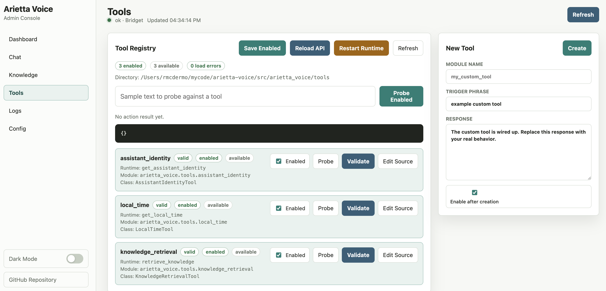

# Arietta Voice


Arietta Voice is a local-first framework for building a wake-word-driven voice
assistant on Apple Silicon Macs. It combines local speech-to-text,
text-to-speech, turn detection, tool routing, markdown knowledge retrieval, and
a web admin console into a customizable assistant runtime. It's like your own private,
custom, locally host Alexa/Echo, but better.

The project is meant to become *your* assistant, not a finished general-purpose
assistant out of the box. As shipped, it is mostly a working runtime and admin
surface; it becomes useful when you provide the assistant persona in `SOUL.md`,
add knowledge articles for your environment, configure the wake word, and add
deterministic or model-called tools for the things you want it to do.

The default assistant persona is named `Bridget`, and the default wake word is
also `Bridget`. Both are easy to change in
[`config/arietta_voice.toml`](./config/arietta_voice.toml).

For a detailed customization walkthrough, see [GETTING_STARTED.md](./GETTING_STARTED.md).

## What This Project Includes

- local speech-to-text with Moonshine
- local text-to-speech with Kokoro
- local VAD and turn-end detection with Silero VAD and Smart Turn
- default local chat with Gemma on MLX
- optional AWS Bedrock chat integration through the same chat-model seam
- deterministic tool routing
- model-requested follow-up tools
- local markdown knowledge retrieval
- editable `SOUL.md` and optional memory file
- a wake-word-first runtime designed for an always-on Mac mini
- authenticated HTTP API and admin console for inspection, chat testing, logs, diagnostics, tools, and knowledge

## Design Scope

The project is intentionally focused on a voice-first assistant runtime with a small, editable surface area:

- the typed config system
- the knowledge indexing and retrieval pipeline
- deterministic tools and model-requested tools
- the local/Bedrock LLM adapter seam
- STT, TTS, VAD, Smart Turn, and audio barge-in handling
- prompt assembly and optional memory consolidation
- a local admin/API surface for operational visibility and configuration workflows

It intentionally does not include:

- webcam presence detection
- camera and vision tools

## Setup

Install the project environment:

```bash
uv sync
```

Recommended on macOS for Kokoro:

```bash
brew install espeak-ng
```

First run downloads model assets as needed. Depending on your config, that can include Moonshine, Kokoro, Smart Turn, and the local MLX chat model.

## Commands

Run the assistant:

```bash
uv run arietta-voice
uv run arietta-voice run
```

Useful variations:

```bash
uv run arietta-voice --no-wake
uv run arietta-voice --wake-word Bridget
uv run arietta-voice --wake-word Bridget --wake-word Arietta
uv run arietta-voice --session-timeout 30
uv run arietta-voice --voice bf_emma
uv run arietta-voice --chat-provider bedrock --model us.anthropic.claude-sonnet-4-20250514-v1:0
uv run arietta-voice --record
uv run arietta-voice --record tmp/session.wav
```

Inspect configuration:

```bash
uv run arietta-voice config
```

Run diagnostics:

```bash
uv run arietta-voice doctor
```

Run the HTTP API and admin console:

```bash
uv run arietta-voice serve
```

The admin console is available at `http://127.0.0.1:8765/admin`.
The initial local credentials are `admin` / `password`; override them with
`ARIETTA_ADMIN_USERNAME` and `ARIETTA_ADMIN_PASSWORD`.

**Screenshot of the Arietta admin console's tool managment panel:**



The voice runtime and web console can run as separate processes. For example,
you can start the voice runtime in one terminal and the admin console in
another:

```bash
uv run arietta-voice
uv run arietta-voice serve
```

In this mode, the admin console still provides observability and editing:
health, status heartbeat, logs, diagnostics, chat testing, knowledge editing,
tool validation, tool source editing, and config-backed tool enablement. The
voice runtime publishes a heartbeat to `logs/runtime_status.json`, which lets
the admin console show whether the separate voice process is running, stopped,
or stale.

The main limitation is process ownership. If the voice runtime was started
manually with `uv run arietta-voice`, the admin console can observe it but
cannot stop or restart that terminal process. After changing tools, knowledge
settings, or config used by the voice runtime, restart the manually started
runtime yourself so it picks up those changes.

The admin console can also start, stop, and restart an API-managed voice
runtime. Use the admin console's Start button when you want the web API to own
the child voice process and make the Start, Stop, and Restart buttons fully
effective. Managed runtime stdout and stderr are written to
`logs/managed_runtime.stdout.log` and `logs/managed_runtime.stderr.log`.

If you use a custom config path, pass the same config to both processes:

```bash
uv run arietta-voice --config config/arietta_voice.toml
uv run arietta-voice serve --config config/arietta_voice.toml
```

For a headless Mac mini or other always-on Mac, use macOS `launchd` to start
the voice runtime and admin console automatically after reboot/login. Because
the voice runtime uses microphone/audio access, run it as a user LaunchAgent
rather than a root LaunchDaemon. See [Run Automatically on macOS With
launchd](./GETTING_STARTED.md#9-run-automatically-on-macos-with-launchd) for a
step-by-step setup.

The Knowledge page can list, create, edit, delete, search, and re-index local
knowledge files inside the configured knowledge directory.

List audio devices:

```bash
uv run arietta-voice devices
```

Work with the knowledge base:

```bash
uv run arietta-voice knowledge-search "what can you help with"
uv run arietta-voice knowledge-index
```

Run tests:

```bash
uv run pytest
```

## Wake Word Behavior

The initial wake-word implementation is local and transcript-based:

- Arietta Voice listens continuously with VAD.
- When speech ends, it transcribes the utterance locally.
- If the transcript starts with a configured wake phrase like `Bridget`, the assistant opens a short active session.
- If the wake utterance also contains a command, like `Bridget what time is it`, the assistant handles that in the same turn.
- If you only say `Bridget`, the assistant answers with the configured acknowledgement and keeps listening for the follow-up.

This approach keeps the system simple and fully local while reusing the existing STT/VAD pipeline. It is also deliberately extensible: the wake-word logic lives in [`src/arietta_voice/wake.py`](./src/arietta_voice/wake.py), so a future acoustic hotword backend can be added without rewriting the runtime.

## Configuration

The main config file is [`config/arietta_voice.toml`](./config/arietta_voice.toml).

The most important editable files are:

- [`config/SOUL.md`](./config/SOUL.md): the system prompt/personality
- `config/MEMORY.md`: optional long-lived memory file, created automatically when memory is enabled
- [`knowledge`](./knowledge): your editable local knowledge articles

The main config sections are:

- `[assistant]`: persona name, identity text, short greetings, goodbye phrases, history length
- `[wake_word]`: wake phrases, acknowledgement, backend, and session timeout
- `[audio]`: TTS, Smart Turn, AEC, chime, and Kokoro settings
- `[models]`: local vs Bedrock chat provider, model ids, AWS settings, STT language, generation settings
- `[prompts]`: `SOUL.md` and memory file locations
- `[memory]`: optional memory behavior
- `[logging]`: runtime log locations
- `[knowledge]`: knowledge directory, index directory, backend, and retrieval scoring knobs
- `[tools]`: deterministic tools checked before the model
- `[model_tools]`: model-requested follow-up tools

Relative paths in the TOML are resolved relative to the config file, not the current shell directory.

## Customizing The Assistant

### Change the assistant name and wake word

Edit [`config/arietta_voice.toml`](./config/arietta_voice.toml):

```toml
[assistant]
name = "Arietta"

[wake_word]
phrases = ["arietta"]
```

### Change the system prompt

Edit [`config/SOUL.md`](./config/SOUL.md). Keep it focused and durable. Project-specific facts should usually live in `knowledge/*.md`, not in the soul file.

### Add knowledge

Add markdown files to [`knowledge`](./knowledge). A template is included at [`knowledge/_template.md`](./knowledge/_template.md).

### Add a deterministic tool

Copy [`src/arietta_voice/tools/tool_template.py`](./src/arietta_voice/tools/tool_template.py) to a new module in the same directory, implement `maybe_handle(...)`, then add the module name to `[tools].enabled`.

Use deterministic tools when:

- the answer should be exact
- routing should be explicit
- the tool itself should produce the final answer

The built-in `local_time` tool is the canonical example.

### Add a model-requested tool

Copy [`src/arietta_voice/model_tools/tool_template.py`](./src/arietta_voice/model_tools/tool_template.py) to a new module in the same directory, implement `invoke(...)`, then add the module name to `[model_tools].enabled`.

Use model-requested tools when:

- the model should decide if the lookup is necessary
- the tool gathers supporting facts instead of speaking directly
- you want one grounded follow-up answer after tool execution

This is the natural path for future home-automation actions and richer environment lookups.

## Bedrock Integration

Local chat is the default:

```toml
[models]
chat_provider = "local"
chat_model = "mlx-community/gemma-4-E4B-it-4bit"
```

To switch chat turns to Bedrock:

```toml
[models]
chat_provider = "bedrock"
chat_model = "us.anthropic.claude-sonnet-4-20250514-v1:0"
bedrock_region = "us-west-2"
bedrock_profile = "default"
```

The rest of the runtime stays the same. STT, TTS, tools, wake word handling, and knowledge retrieval remain local.

## Recommended Dedicated Mac Mini Setup

For an always-on voice assistant box, the intended target is a dedicated Apple Silicon Mac mini with:

- a reliable USB microphone or speakerphone
- a good near-field speaker
- a quiet location with stable power
- local knowledge and tool configuration committed alongside the project

The current repo is a strong foundation for a home assistant or office assistant. Home automation should be added through tools, not by hardcoding behaviors into the runtime.

## Project Layout

```text
config/                 Config, SOUL, and memory example files
knowledge/              User-editable markdown knowledge
src/arietta_voice/      Runtime, models, knowledge, audio, and tooling code
src/arietta_voice/tools/        Deterministic tools
src/arietta_voice/model_tools/  Model-requested tools
tests/                  Focused unit tests for config, tools, knowledge, wake word, and model tooling
```

## Notes

- Licensed under the Apache License 2.0.
- The default wake-word backend is transcript-based, not an acoustic hotword model.
- The local chat path is optimized for Apple Silicon and MLX.
- `knowledge-index` is only required when you use the semantic or hybrid backend.
- `backend = "keyword"` is the simplest starting point for a user-customized deployment.
