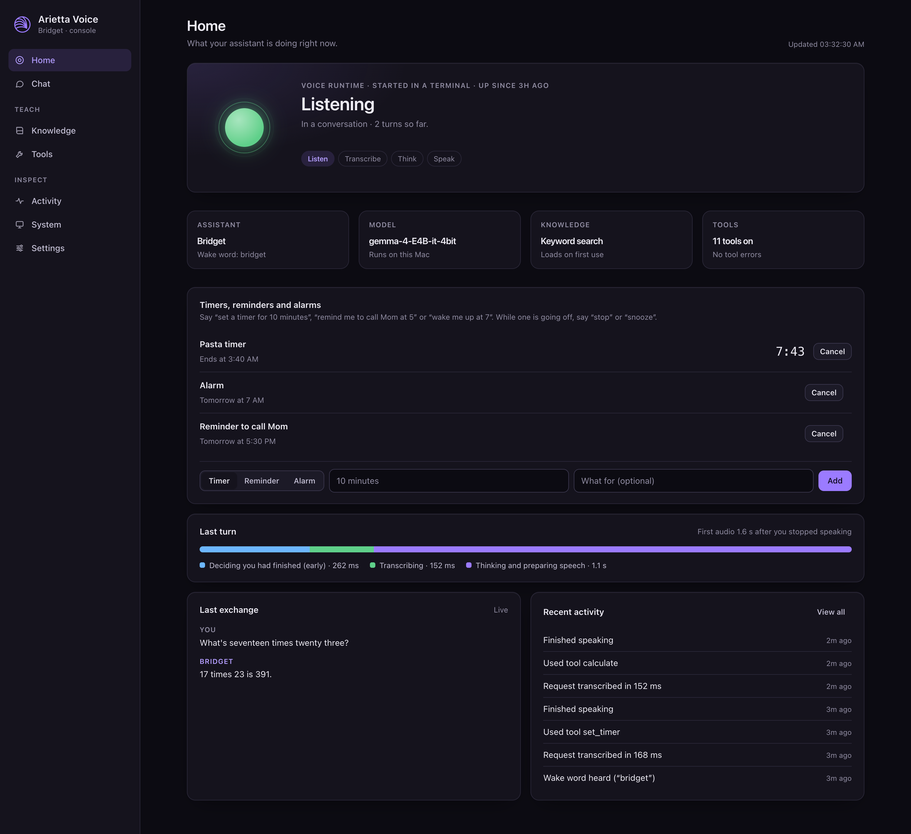

# Arietta Voice


Arietta Voice is a local-first framework for building a wake-word-driven voice
assistant on Apple Silicon Macs. It combines local speech-to-text,
text-to-speech, turn detection, tool routing, markdown knowledge retrieval, and
a web admin console into a customizable assistant runtime. It's like your own private,
custom, locally host Alexa/Echo, but better.

The project is meant to become *your* assistant, not a finished general-purpose
assistant out of the box. As shipped, it is mostly a working runtime and admin
surface; it becomes useful when you provide the assistant persona in `SOUL.md`,
add knowledge articles for your environment, configure the wake word, and add
tools for the things you want it to do.

The default assistant persona is named `Bridget`, and the default wake word is
also `Bridget`. Both are easy to change in your private
`config/arietta_voice.local.toml` after running `uv run arietta-voice config-init`.

For a detailed customization walkthrough, see [docs/getting-started.md](docs/getting-started.md).

For planned improvements, see [ROADMAP.md](ROADMAP.md). The
[release guide](docs/releasing.md) explains app versioning, and
[CHANGELOG.md](CHANGELOG.md) records user-visible changes.

## What This Project Includes

- local speech-to-text with Moonshine
- local text-to-speech with Kokoro
- local VAD and turn-end detection with Silero VAD and Smart Turn
- default local chat with Gemma on MLX
- optional AWS Bedrock chat integration through the same chat-model seam
- tools with instant answers and model calls, with argument schemas and time limits
- MCP servers for more tools (a calendar, notes, a smart home), set up from the console, with a spoken "Should I…?" before anything that changes something
- local markdown knowledge retrieval
- editable `SOUL.md` and optional memory file
- a wake-word-first runtime designed for an always-on Mac mini
- authenticated HTTP API and admin console for inspection, chat testing, logs, diagnostics, tools, and knowledge

## Design Scope

The project is intentionally focused on a voice-first assistant runtime with a small, editable surface area:

- the typed config system
- the knowledge indexing and retrieval pipeline
- tools, from instant answers to model calls
- the local/Bedrock LLM adapter seam
- STT, TTS, VAD, Smart Turn, and audio barge-in handling
- prompt assembly and optional memory consolidation
- a local admin/API surface for operational visibility and configuration workflows

It intentionally does not include:

- webcam presence detection
- camera and vision tools

## Setup

Install the project environment:

```bash
uv sync
```

Recommended on macOS for Kokoro:

```bash
brew install espeak-ng
```

First run downloads model assets as needed. Depending on your config, that can include Moonshine, Kokoro, Smart Turn, and the local MLX chat model.

## Commands

Run the assistant:

```bash
uv run arietta-voice
uv run arietta-voice run
```

Useful variations:

```bash
uv run arietta-voice --version
uv run arietta-voice --no-wake
uv run arietta-voice --wake-word Bridget
uv run arietta-voice --wake-word Bridget --wake-word Arietta
uv run arietta-voice --session-timeout 30
uv run arietta-voice --voice bf_emma
uv run arietta-voice --chat-provider bedrock --model us.anthropic.claude-sonnet-4-20250514-v1:0
uv run arietta-voice --record
uv run arietta-voice --record tmp/session.wav
```

Inspect configuration:

```bash
uv run arietta-voice config
```

Run diagnostics:

```bash
uv run arietta-voice doctor
```

Set up admin credentials once, then run the HTTP API and admin console:

```bash
uv run arietta-voice admin-setup
uv run arietta-voice serve
```

The admin console is available at `http://127.0.0.1:8765/admin`.
There is no default password. `admin-setup` prompts without echoing your password
and stores a salted PBKDF2-SHA256 hash in ignored, owner-only
`config/arietta_voice.admin.json`. The username defaults to `admin`; use
`--username` to change it and `--replace` to rotate credentials. Passwords must
contain at least 12 printable ASCII characters. Restart the API after rotation.

Alternatively, supply `ARIETTA_ADMIN_PASSWORD` and optionally
`ARIETTA_ADMIN_USERNAME` through your environment. An explicitly set environment
password takes precedence over the credential file and must meet the same
requirements. The server refuses to start without valid credentials.

Keep the default loopback binding. For remote use, put the service behind HTTPS
and list exact hostnames in comma-separated `ARIETTA_ADMIN_ALLOWED_HOSTS`;
HTTP Basic credentials are not encrypted by HTTP itself. The API rejects
untrusted Host headers and cross-origin browser mutations, and marks responses
non-cacheable. These controls do not provide TLS or a multi-user permission model.

The console has seven sections: **Home** (live assistant status, runtime
controls, timers, reminders and alarms, the last turn's timing and the current
exchange), **Chat** (answers stream as they are written), **Knowledge**,
**Tools**, **Activity** (the event log), **System** (health checks, audio and
process detail) and **Settings** (common settings as forms, plus everything in
effect). It follows your system light or dark preference.




The voice runtime and web console can run as separate processes. For example,
you can start the voice runtime in one terminal and the admin console in
another:

```bash
uv run arietta-voice
uv run arietta-voice serve
```

In this mode, the admin console still provides observability and editing:
health, status heartbeat, logs, diagnostics, chat testing, knowledge editing,
tool validation, opt-in source editing, and private-config-backed tool enablement. The
voice runtime publishes a heartbeat to `logs/runtime_status.json`, which lets
the admin console show whether the separate voice process is running, stopped,
or stale.

The main limitation is process ownership. If the voice runtime was started
manually with `uv run arietta-voice`, the admin console can observe it but
cannot stop or restart that terminal process. After changing tools, knowledge
settings, or config used by the voice runtime, restart the manually started
runtime yourself so it picks up those changes.

The admin console can also start, stop, and restart an API-managed voice
runtime. Use the admin console's Start button when you want the web API to own
the child voice process and make the Start, Stop, and Restart buttons fully
effective. Managed runtime stdout and stderr are written to
`logs/managed_runtime.stdout.log` and `logs/managed_runtime.stderr.log`.

If you use a custom config path, pass the same config to both processes:

```bash
uv run arietta-voice --config config/arietta_voice.toml
uv run arietta-voice serve --config config/arietta_voice.toml
```

For a headless Mac mini or other always-on Mac, use macOS `launchd` to start
the voice runtime and admin console automatically after reboot/login. Because
the voice runtime uses microphone/audio access, run it as a user LaunchAgent
rather than a root LaunchDaemon. See [Run Automatically on macOS With
launchd](docs/getting-started.md#9-run-automatically-on-macos-with-launchd) for a
step-by-step setup.

The Knowledge page can list, create, edit, delete, search, and re-index local
knowledge files inside the configured knowledge directory.

List audio devices:

```bash
uv run arietta-voice devices
```

Work with the knowledge base:

```bash
uv run arietta-voice knowledge-search "what can you help with"
uv run arietta-voice knowledge-index
```

Run the isolated unit tests and synthetic evaluations:

```bash
uv sync --locked --group dev
uv run --locked pytest
```

Tests use temporary config/knowledge and fake models/audio; they preserve local
settings and require no credentials. CI adds tracked-private-file, locked-install,
version, and wheel/sdist checks on Apple Silicon. See
[synthetic evaluations and CI](evals/README.md) for coverage, individual checks,
and the remaining hardware/model validation gates.

For actual microphone/speaker checks and a bounded local soak, follow
[hardware validation](evals/HARDWARE_VALIDATION.md). The opt-in harness uses an
isolated synthetic persona and preserves private settings and knowledge.

For repeatable stage timings and 100 warm no-tool turns on the local Mac, see
[the latency baseline](evals/LATENCY_BASELINE.md). It uses paced synthetic
input and real speaker output, with an explicit software timing boundary.

The benchmark harnesses live in [`bench/`](bench/README.md). Concluded
experiments (Kokoro ONNX/MLX, Moonshine streaming, ONNX environment and audio
underflow investigations) are kept for reference under
[`docs/archive/experiments/`](docs/archive/experiments/) with their harnesses
in `bench/archive/`; they are not part of the default test run.

## Wake Word Behavior

The initial wake-word implementation is local and transcript-based:

- Arietta Voice listens continuously with VAD.
- When speech ends, it transcribes the utterance locally.
- If the transcript starts with a configured wake phrase like `Bridget`, the assistant opens a short active session.
- If the wake utterance also contains a command, like `Bridget what time is it`, the assistant handles that in the same turn.
- If you only say `Bridget`, the assistant answers with the configured acknowledgement and keeps listening for the follow-up.

This approach keeps the system simple and fully local while reusing the existing STT/VAD pipeline. It is also deliberately extensible: the wake-word logic lives in [`src/arietta_voice/wake.py`](src/arietta_voice/wake.py), so a future acoustic hotword backend can be added without rewriting the runtime.

## Configuration

The tracked [`config/arietta_voice.toml`](config/arietta_voice.toml) provides
shared defaults. Create private settings and a private persona before customizing:

```bash
uv run arietta-voice config-init
```

This snapshots your effective settings into `config/arietta_voice.local.toml`,
copies the current persona to `config/SOUL.local.md`, and points the private
config at that copy. It keeps the originals and stores backups in
`config/.private-backups/`. Existing private files are never overwritten.
All generated private files are owner-only and ignored by Git. If you already
edited the tracked files, review the private copies before restoring the tracked
files to their committed defaults. Ignore rules do not protect tracked files or
remove content from earlier commits.

The console's Settings page can also change the common settings (name, wake
word, voice, model temperature, timers, weather, memory, logging); it validates
them and writes the private config for you.

Precedence is built-in defaults, selected base TOML, its sibling `.local.toml`,
then CLI runtime overrides. Sections merge by setting; arrays replace the entire
base array, including `[]`. With `--config /path/custom.toml`, the sibling is
`/path/custom.local.toml`; unrelated project overrides are not loaded. Relative
paths resolve beside the selected config. Custom locations outside `config/`
need their own ignore rules. A full snapshot keeps existing values pinned;
delete a private setting to inherit its shared default again.

The most important editable files are:

- `config/arietta_voice.local.toml`: private configuration overrides
- `config/SOUL.local.md`: private system prompt/personality
- `config/MEMORY.md`: optional long-lived memory file, created automatically when memory is enabled
- [`knowledge`](knowledge): your editable local knowledge articles

The main config sections are:

- `[assistant]`: persona name, identity text, short greetings, goodbye phrases, history length
- `[wake_word]`: wake phrases, acknowledgement, backend, and session timeout
- `[audio]`: TTS, Smart Turn, AEC, chime, and Kokoro settings
- `[models]`: local vs Bedrock chat provider, model ids, AWS settings, STT language, generation settings
- `[prompts]`: `SOUL.md` and memory file locations
- `[memory]`: optional memory behavior
- `[logging]`: runtime log locations, content opt-in, and event-log rotation
- `[knowledge]`: knowledge directory, index directory, backend, and retrieval scoring knobs
- `[tools]`: enabled tools, in order, the standard tools you switched off, and the folder for your own tools
- `[admin]`: source-editing permission (disabled by default)
- `[runtime]`: turn, endpoint detection, and model startup time limits
- `[timers]`: where timers and reminders are kept, how often an unanswered one repeats, the snooze length and the alert tone
- `[weather]`: your town or city and units for the optional weather tool
- `[mcp]`: where MCP servers are listed, remembered approvals, and connection and call time limits

Relative paths in the TOML are resolved relative to the config file, not the current shell directory.

`max_history_turns` counts complete user/assistant pairs; `0` disables conversation
history. Invalid TOML types, unknown settings, and unsupported values fail at
startup with the setting name. The current audio pipeline requires 16,000 Hz
input and 512-sample chunks.

### Audio limits and failure recovery

Choose devices with `uv run arietta-voice devices`. It reports exact names,
host-qualified selectors, direction capabilities and current OS defaults.
Copy a `selector` into the `[audio]` section of your ignored
`config/arietta_voice.local.toml`, for example:

```toml
[audio]
input_device = "Core Audio::Jabra SPEAK 410 USB"
output_device = "Core Audio::Jabra SPEAK 410 USB"
```

Use the names reported on your own machine. Matching is exact and ignores case;
the input/output direction disambiguates separate microphone and speaker entries.
Identical names on different hosts require `HOST::NAME`. Remaining duplicates or
missing explicit devices wait for correction/reconnection, without falling back.
Numeric indices are diagnostic only and must not be saved as selectors.
Empty strings (the example defaults) or omitted settings use the OS defaults
when connecting. CLI `run --input-device "NAME" --output-device "NAME"`
overrides config for that run; an empty argument restores default selection.
Restart after changing config or changing the OS default during a healthy session.

Capture inactivity, callback stalls, long sleep/scheduling gaps and returned
PortAudio errors stop the current turn. The runtime closes streams, clears the
conversation and buffered audio, and enters `waiting_for_audio` while keeping its
heartbeat alive. It refreshes the device inventory and retries acquisition with
exponential backoff, capped at 30 seconds, until the selected devices return.
A fresh microphone callback is required before resuming. Say the wake phrase
again after recovery (wake-disabled mode starts a fresh session). Interrupted
turns and tool actions are never automatically replayed. Speech and chimes use
the selected output. An explicit WAV recording continues in the same file across
reconnects, with a gap for unavailable capture.

`audio.device_stall_s` defaults to `3.0` (range 1–30 seconds), and
`audio.reconnect_delay_s` to `1.0` (range 0.1–30 seconds). The admin reliability
panel shows device state, last selected routes, failures and recoveries.
Long scheduling pauses or forward wall-clock jumps may conservatively reset a
session. Recovery cannot interrupt a native audio call that never returns;
that case still requires restarting the voice process. Physical USB disconnect
and sleep/wake checks remain pending; see [device recovery validation](evals/DEVICE_RECOVERY_VALIDATION.md).

These defaults are defined in the application and documented in the example
and distribution TOML configs. Existing configs inherit omitted settings.
Override only the settings you want in your private `.local.toml`; restart the
voice runtime and API to apply them.

| Setting | Default | Behavior |
| --- | --- | --- |
| `audio.queue_max_chunks` | `64` | About 2 seconds of queued microphone input; drops oldest chunks under load. |
| `audio.max_utterance_s` | `30.0` | Maximum captured utterance, including trailing silence. |
| `audio.recording_queue_max_chunks` | `256` | Bounded queue for the background WAV writer. |
| `audio.max_recording_s` | `3600.0` | Maximum saved audio per `--record` run. Listening continues after the limit. |
| `audio.playback_reference_s` | `4.0` | Rolling echo-cancellation reference, rather than the entire response. |
| `audio.pre_roll_ms` | `200.0` | Up to 500 ms of local audio before detected speech; `0` disables it. Barge-in rounds up to a 32 ms capture chunk. Included in the utterance limit. |
| `audio.endpoint_early_ms` | `250.0` | With Smart Turn on, also check for the end of a turn after this much silence and start on the answer at once if the model is confident, which saves about 0.4 s per turn. Until `silence_ms` has passed the assistant keeps listening; if you carry on, it discards that attempt and continues with the whole utterance. `0` waits for `silence_ms` every time. Ignored when it is not shorter than `silence_ms`. |
| `audio.endpoint_early_threshold` | `0.7` | Smart Turn probability, 0.5–1, required to end the turn at the early check. The normal check after `silence_ms` still uses 0.5. |
| `models.reuse_prompt_prefix` | `true` | Local model only. Reuses the processed start of each conversation prompt (persona, tool instructions, earlier turns), which cuts the wait for the first word. An answer can occasionally differ from what the same prompt would produce without reuse; set `false` to compare. |
| `models.native_tool_calls` | `true` | Local model only. Offers tools through Gemma 4's own tool-calling format and lets it call up to three in a turn. It chose the right tool far more often than the prompted JSON format, which Bedrock still uses and `false` restores. |
| `audio.tts_trim_silence` | `true` | Cut the silence each synthesised clip starts and ends with to 40 ms and 100 ms. MLX Kokoro pads clips with about 0.3 s before and 0.4 s after; ONNX Kokoro is already close to these margins. |
| `audio.aec_delay_ms` | `0.0` | Additional measured acoustic/device delay, 0–500 ms, beyond reported output latency. No automatic calibration. |
| `runtime.turn_timeout_s` | `60.0` | Shared budget for STT, chat/tools and speech generation/playback. Also limits web chat. Background memory gets its own budget, capped at 30 seconds. |
| `runtime.endpoint_timeout_s` | `5.0` | Separate Smart Turn deadline for each endpoint check. |
| `runtime.startup_timeout_s` | `300.0` | Model-worker warmup deadline; increase for slow first-run downloads. |

Oversized or interrupted input is discarded until a quiet interval; it is not
submitted as a truncated command. Recordings stream to an owner-only WAV file
instead of accumulating in RAM. A slow disk can drop recording chunks; the
dashboard reports dropped chunks, recording limits, and write failures. Such
recordings may be incomplete. A forced process kill can leave an unfinished WAV.

Capture chunks retain their ADC timestamps. AEC aligns them with a bounded
timeline of submitted speaker blocks, including gaps between clauses, and
processes continuous 10 ms frames. Its 10 ms framing delay is flushed into the
cleaned interruption prefix so speech is not lost at handoff. Pre-roll stays
in bounded RAM and is cleared at turn/session boundaries and capture gaps;
existing explicit recording remains separate. Voice barge-in requires AEC to be
enabled and the configured consecutive-speech threshold; keyboard cancellation
also works before audio starts, between clauses and during final device draining.

Output timing is estimated from blocking PortAudio writes, reported device
latency and queued sample duration. It is not a measured DAC timestamp or an
acoustic guarantee. Capture gaps/output underflows reset alignment; playback
completion events include reset/underflow counts and reset reasons without audio
or text. Normal ADC packets straddling playback startup are discarded without
resetting a fresh AEC. Runtime audio status separates actual queue overruns by
capture phase from intentional discards at turn boundaries, during transcription,
and while awaiting first output. Those waits already discarded capture before
resuming listening or starting playback; voice barge-in still begins with output,
not during initial generation. Endpoint decisions retain capture because an
unfinished utterance may continue. See
[AEC and interruption validation](evals/AEC_VALIDATION.md) for evidence and limits.
The [capture/alignment investigation](docs/archive/experiments/CAPTURE_ALIGNMENT_INVESTIGATION.md)
documents the startup/wait fixes and isolated MLX repeat.

During gaps after speech begins, the player feeds bounded 20 ms silence blocks
into available device capacity and includes them in the AEC reference. It polls
the producer every 10 ms without adding a startup prebuffer. Genuine output
underflows still reset alignment. Playback events include bounded write/wait/
capture-poll timing metadata to help distinguish generation gaps from scheduling
stalls. See the [output-underflow investigation](docs/archive/experiments/OUTPUT_UNDERFLOW_INVESTIGATION.md)
for matched device probes, live checks and limitations.
The opt-in [forced-gap live protocol](evals/FORCED_GAP_VALIDATION.md) exercises
the same player with microphone/AEC active and checks interruption during and
after a deliberate pause, with dedicated scenario and audio-fault gates.
The [continuous live/load soak](evals/LIVE_LOAD_SOAK.md) combines paced synthetic
questions with physical capture/AEC and audible replies, bracketed by live checks
around a continuous worker/device load session.

Heavy STT, endpoint, chat, tool, and TTS work runs in a persistent spawned process
with one operation at a time. On timeout, crash, or model/tool exception, that
worker is terminated before another is created. The voice runtime clears failed
turn state and resumes listening; successful history remains. A failed memory
update does not undo an already delivered answer. Memory writes replace the old
file atomically, and memory extraction is skipped when speech interrupts an answer.

Tools are **never automatically retried**. A timed-out external action may already
have happened, so check its result before repeating it. Web chat returns `503`
when busy, `504` on timeout, or `502` on inference failure, with no failed history
entry. Voice and web chat each have a separate worker; they do not yet share a
single GPU scheduler. The timeout bounds inference work, not a stuck native audio
driver or arbitrary subprocesses started by a custom plugin. Admin tool-validation,
probe/invoke, and knowledge-index maintenance actions are outside the chat deadline.

Each turn has a cancellation token. The web console's Chat page has a **Stop**
button; terminal keypresses interrupt voice generation/playback, and detected
speech interrupts playback. Cancellation discards queued output, aborts speaker
output before waiting for generation cleanup, and terminates a worker blocked
in model/tool code. The next turn can start with a fresh worker. Cancelled or
partially spoken replies are excluded from history and memory; cancelling memory
work after a fully delivered answer preserves that answer. Cancellation has its
own counter and is not reported as a failed turn. It cannot undo an external
action or memory write that already completed.

API clients can supply a fresh `request_id` with each `POST /api/chat` (1–64
letters, digits, underscores or hyphens), then use authenticated
`POST /api/chat/{request_id}/cancel`. Cancelled chat requests return `409`.
Cancellation can arrive before its chat request; the last 128 completed/cancelled
IDs are retained to reject stale requests. Always generate a new ID per turn.
Closing a browser tab alone does not request cancellation.

`POST /api/chat/stream` takes the same body and returns the answer as
server-sent events while it is generated: `{"kind": "clause", "text": ...}` for
each clause (as voice would speak it), then `{"kind": "done", "result": ...}` or
`{"kind": "error", "status": ..., "detail": ...}`. A busy worker or a reused
request ID fails with the usual status before the stream starts. The console's
Chat page uses it, so answers appear as they are written.

Voice and web chat now use the same conversation service for prompts, history,
tool policy and speech sanitization, while retaining separate worker processes.
The speech handoff has fixed bounds: two text items of at most 12,000 characters
each, and eight audio frames of at most 4,096 mono float32 samples each (128 KiB
queued PCM), plus one producer-held and one consumer-held frame. A full queue
pauses its producer within the shared turn deadline. Backend TTS chunks are
validated and limited to 30 seconds before slicing; temporary allocations inside
native models are outside these queue limits. These internal bounds need no new
TOML settings.

### Background memory

When `[memory].enabled` is true, a fully delivered voice turn queues a memory
update and immediately returns to listening. Extraction and optional
consolidation begin after one second of quiet listening, using the same model
worker. No second model is loaded. The console Chat page still does not write memory.
No config migration or new private setting is required.

The queue holds at most two pending turns plus one active job. Each user/assistant
text is limited to 12,000 characters; oversized jobs are skipped, and queue
pressure drops the oldest pending turn. Jobs exist only in RAM. Failed,
interrupted, dropped and shutdown-discarded jobs are not automatically retried,
so optional memory is best-effort. Each job has an independent deadline of
`min(runtime.turn_timeout_s, 30)` seconds; memory time is excluded from the
interactive turn duration.

Detected speech pauses memory scheduling immediately. The generator is closed
at the next token boundary before endpoint detection or response generation can
use its model. A native call that does not yield within a 100 ms grace period
is cancelled by terminating its worker; the next request reloads models. The
listening loop continues capturing during that cancellation, and foreground
inference allows up to 2.5 seconds for ownership to be released. This fallback
can add next-turn startup latency; it is not a guarantee of zero interruption
latency. Pending jobs wait for the next quiet interval.

Extraction and consolidation produce one proposal before touching the memory
file. Commit compares the file with the original snapshot; a detected intervening
edit discards the proposal. Successful changes use an owner-only atomic
replacement. A write already committed before preemption is retained. Existing
memory over 128,000 characters and generated memory output over 12,000 characters
are rejected without truncation. Consolidation still follows the configured
session-turn cadence; skipped jobs may skip a consolidation opportunity.

Runtime details expose `reliability.memory` queue/active state and completed,
cancelled, failed, dropped and conflict counters. Background failures do not mark
a delivered turn as failed. Diagnostics include counts and exception types,
never queued conversation text or memory contents. Shutdown clears pending text,
stops active work, then closes the inference worker.

### Faster speech with MLX Kokoro (optional)

ONNX Kokoro, the default, needs about 450 ms of CPU time before the first word
of each answer. Kokoro on MLX uses the GPU and produces it in about 190 ms,
which made answers 0.3 to 0.4 s quicker in the latency benchmark (1.28 s
against 1.59 s median). It is not yet the default: one long benchmark run had
an audio underflow, and it has not been through a live soak.

To try it, install the extra packages and the model, then point your private
config at the model directory:

```bash
uv sync --group mlx-speech
uv run hf download mlx-community/Kokoro-82M-bf16 config.json kokoro-v1_0.safetensors voices/af_heart.safetensors --local-dir models/Kokoro-82M-bf16
```

```toml
# config/arietta_voice.local.toml
[audio]
tts_backend = "mlx"
mlx_kokoro_model = "../models/Kokoro-82M-bf16"
```

The directory name must contain `kokoro`, and the voice file must match
`audio.voice`. A relative path resolves beside the config file. To return to
ONNX, remove those two lines, or run once with `--tts-backend onnx`. Plain
`uv sync` removes the extra packages again. MLX supports the American and
British English voices only.

The group installs misaki for pronunciation. misaki declares support only for
Python below 3.13; uv installs it regardless and it works, but pip would refuse
it. It also brings in `phonemizer-fork`, which installs over the same files as
the `phonemizer` package ONNX Kokoro uses; ONNX speech was checked to produce
identical audio with both installed.

### Token streaming and early speech

The local MLX adapter and Bedrock adapter emit incremental text and completion
events. Voice sends completed sentences or clauses to Kokoro as they become
available, with a 240-character clause limit and a 12,000-character response
limit. Sentence splitting preserves decimals and common abbreviations, flushes
the final fragment, and splits long unpunctuated text at a word boundary when
possible. Very short answers may finish generating before playback begins.

One worker alternates token generation and clause synthesis; the speaker drains
the bounded audio queue concurrently. Models are not accessed from competing
threads. This starts speech early without adding a second loaded model or an
unbounded token backlog. Output polling continues between clauses so detected
speech can interrupt during a generation gap, using the existing AEC/barge-in
settings. Cancellation closes the provider stream and speech generator, or
terminates their worker when blocked. A later stream failure can leave a spoken
fragment, but it never commits a partial answer or retries an external action.

When model tools are enabled, the first generation may be either a tool request
or the answer itself, and it is streamed. A response that begins as JSON (plain
or fenced) is a tool request: it stays buffered until it has been parsed and the
tool has run, then the final answer streams. Anything else is a direct answer
and is spoken as it arrives, with no second generation. Malformed or unavailable
tool requests fail without speaking the payload. If a tool request appears after
a direct answer has started, the turn stops; the sentence already spoken stays
spoken. Deterministic tool replies are already complete. The first spoken clause
may end at a comma or dash once it is 25 characters long, so speech can begin
before a long opening sentence has finished.

After an early end-of-turn decision the turn is provisional until the normal
silence window has passed. The thinking chime waits for that point, because the
microphone would hear it. If speech resumes first, the attempt is dropped without
cancelling the inference call in flight (cancelling one stops the worker and its
loaded models), a `turn_resumed` event is logged, and the same utterance carries
on. A discarded attempt may already have logged a transcript event for the first
part. Once audio starts, further speech is an ordinary interruption.

Each spoken microphone turn logs a `turn_timing` event with milliseconds from the
end of speech: the wait to decide the turn had ended, transcription time, first
audio and the whole turn. It contains no conversation text.
The console Chat page shares this conversation policy but still displays one final
response; this change does not introduce an HTTP streaming endpoint.

Bedrock uses [ConverseStream](https://docs.aws.amazon.com/bedrock/latest/APIReference/API_runtime_ConverseStream.html),
which requires `bedrock:InvokeModelWithResponseStream` permission and a model
that supports streaming. Reasoning and native tool payloads are not treated as
speakable text; incomplete/error streams are rejected. There is no automatic
fallback/retry to the batch API after a streaming failure. MLX uses the locked
[`mlx-vlm` streaming adapter](https://github.com/Blaizzy/mlx-vlm).
No private settings are migrated or rewritten; restart the voice runtime and
API to load this code. Full latency and acoustic interruption targets still
require the Phase 2 benchmark and hardware validation.

The admin dashboard shows the processing stage, turn budget, microphone queue,
recovery counters, and recording warnings while a background heartbeat continues
during model work. Technical process/file details are expandable. Chat prevents
duplicate submissions, retains failed drafts, and shows actionable errors. Source
and knowledge editors warn before leaving with unsaved changes. Larger frontend
restructuring and polling improvements remain in Phase 4 of the roadmap.

### Privacy and logging

Public `/health` returns only liveness and the app version. Detailed diagnostics
and runtime state remain at authenticated `/api/health`.

Conversation text is omitted from event logs, process logs, and the runtime
status file by default. Passive speech that does not activate the assistant is
never logged as text, even with content logging enabled. Active conversation
text can be enabled for debugging in the existing `[logging]` section:

```toml
content_enabled = false
max_bytes = 5000000
backup_count = 3
```

Set `content_enabled = true` only when you want active speech, responses, and
model-tool details in logs, plus active conversation text in runtime status.
The runtime monitor's last-user/last-assistant fields are otherwise blank.
Interactive text-only responses remain visible in a terminal. Redirected
runtime responses require content opt-in.
Uncaught voice-runtime failures report the exception type and exit with a
nonzero status; full exception details require the same content opt-in.

The JSONL event log rotates at 5 MB by default and retains three backups
(`events.jsonl.1` through `.3`). `backup_count = 0` keeps no archives. Event logs
and newly written status files use owner-only permissions. Rotation does not
cover launchd's stdout/stderr files or remove content already written by earlier
versions. Review old logs and recordings separately if you need to remove them.

These settings control diagnostic persistence. Optional memory still saves
facts when enabled, and `--record` explicitly saves microphone audio, including
passive audio. Bedrock sends assembled text prompts—including relevant history,
persona, memory, knowledge snippets, and tool context—to AWS; speech recognition
and synthesis remain local. Custom plugins may have their own logging or network
behavior. Prefer the AWS credential chain over putting AWS credentials in TOML;
if used, keep them only in private config. Admin/CLI config displays redact AWS
credentials, and admin password hashes are kept separately from app config.

### Admin tool permissions

Inventory and source views inspect syntax and literal metadata without importing
plugin code, so a listed tool is not yet proven to load; the Tools page says so.
Explicit Validate, Test, Invoke, Save, and Preview model instructions actions
may import and execute existing plugins. Instruction preview uses
`POST /api/model-tools/instructions`.

Creating tools and saving Python source are disabled by default, including at
the HTTP endpoints. To enable them deliberately, add this to private config and
restart the API:

```toml
[admin]
allow_source_editing = true
```

Saving source can execute code with the API process's privileges. Tool enablement
changes are written atomically to private config; they preserve unrelated settings
and never modify the tracked base. Restart an already-running voice process to
apply changes there.

## Customizing The Assistant

### Change the assistant name and wake word

Edit `config/arietta_voice.local.toml`:

```toml
[assistant]
name = "Arietta"

[wake_word]
phrases = ["arietta"]
```

### Change the system prompt

Edit `config/SOUL.local.md`. Keep it focused and durable. Project-specific facts should usually live in `knowledge/*.md`, not in the soul file.

### Add knowledge

Add markdown files to [`knowledge`](knowledge). Copy the template at
[`examples/knowledge-template.md`](examples/knowledge-template.md) into a new
file there. Only `knowledge/README.md` and `knowledge/getting-started.md` are
tracked by default; other knowledge files and subdirectories are ignored.
Keep personal content in new files, since edits to the two starter documents
remain tracked. See the [knowledge README](knowledge/README.md) for existing
tracked files and custom knowledge directory locations.

### Add a tool

Put a Python file in [`tools/`](tools), then switch it on from the console's
Tools page, or add its name to `[tools].enabled` in your private config (the
whole list, in order, before `search_knowledge`). [`tools/README.md`](tools/README.md)
explains the format and [`tools/example_dice.py`](tools/example_dice.py) is a
working example. Your tools live outside the installed package, so upgrades
leave them alone, and only the README and the example are tracked by Git.

Every tool has a name, a description of when to use it, a JSON schema for its
arguments and a `run` method. A tool can work in two ways, or both:

- **Instant answer.** Give it `triggers` (regular expressions). A matching
  request runs the tool at once, and if it returns `speak`, that is the answer;
  the model is not asked. Use this when the answer must be exact, like the time.
- **Model call.** The model sees the tool's name, description and arguments,
  and can call it before answering, using the tool's `content`. Use this when
  the model should decide whether it needs the tool, or which arguments. The
  local model calls tools natively (Gemma 4's own format) and may call up to
  three in a turn; Bedrock gets one call through a prompted JSON format. With
  `speaks_for_itself = True`, a tool's `speak` is the answer even when the model
  called it, as the timer tools do.

Arguments are checked against the schema before a tool runs. A tool that fails,
times out or does not exist is reported to the model, which answers without it
instead of the turn failing. The built-in tools are `assistant_identity`,
`local_time`, `set_timer`, `set_reminder`, `set_alarm`, `check_timers`,
`cancel_timer`, `calculate`, `date_math`, `search_knowledge` and `system_info`,
plus the optional `weather` (see below).

`calculate` works out arithmetic and unit conversions exactly, since the small
model gets sums wrong: "what's seventeen times twenty three?", "15% of 80",
"square root of 2", "convert 5 miles to kilometers", "how many cups are in a
liter". It evaluates a parsed expression of numbers and operators only, never
arbitrary code. `date_math` answers questions about dates: "how many days until
Christmas?", "what day of the week is July 4th?", "what's the date in three
weeks?", "how many days since Halloween?", "how many days between March 1 and
June 15?". It knows the common US holidays, including Easter and Thanksgiving.

New built-in tools switch on by themselves after an upgrade, even if your
private config has its own tool list. That list is `[tools].enabled`, in order,
plus `[tools].disabled`, the standard tools you switched off; a standard tool in
neither is new, so it is switched on just before the next standard tool in your
list (after your own tools). The console's Tools page saves both lists. A list
saved by 0.2.0rc2 or earlier, before `disabled` existed, is read the same way:
standard tools of its release that it leaves out stay off, and later ones are
added.

Configs from before tools were unified keep working: `[model_tools].enabled`
is still read and added to `[tools].enabled`, and `knowledge_retrieval` means
`search_knowledge`. Saving the tool list from the console writes the new form.

### Timers, reminders and alarms

Ask for them the way you would ask a person:

- "Set a 10 minute pasta timer", "timer for an hour and a half"
- "Remind me to call Mom at 5:30", "remind me in 20 minutes to take the bread out",
  "remind me tomorrow morning that the bins go out"
- "Wake me up at 7", "set an alarm for 6:30 tomorrow"
- "How much time is left?", "what reminders do I have?", "is my pasta done?"
- "Cancel the pasta timer", "cancel all my reminders", "never mind the alarm"

Common phrasings like these are answered instantly, without the model. Anything
else reaches the model, which can call the timer and reminder tools. An alarm
without "am" or "pm" means the morning when it is for waking up or for another
day.

When one is due, the assistant plays a short tone and says it, between turns and
never over you. It repeats every 30 seconds until you answer, up to four more
times. While it is going off, "stop", "okay" or "thanks" stop it and "snooze" or
"snooze for 10 minutes" puts it off, with no wake word needed; anything else you
ask the assistant also counts as having heard it. Nothing else is answered
without the wake word.

Timers and reminders are kept in `state/timers.json` (private and ignored by
Git), so they survive a restart. If the assistant was off when one was due, it
is announced, with how late it is, when the assistant starts again. The
console's Home page lists them with a countdown and can add, stop and cancel
them.

The timer tools are on by default, also after an upgrade from a version without
them, unless your private config lists them in `[tools].disabled`.

### Weather (optional)

The `weather` tool answers "what's the weather like?", "will it rain
tomorrow?", "do I need an umbrella?", "what's the forecast for this weekend?"
and "what's the weather in Paris on Friday?". It is off until you choose a place,
because it is the one built-in tool that sends anything off the machine: the
place name (once, to find its coordinates) and those coordinates go to
[Open-Meteo](https://open-meteo.com), which needs no account or key. Answers are
cached for ten minutes. To turn it on, in `config/arietta_voice.local.toml`:

```toml
[weather]
location = "Seattle"   # or "Portland, Maine"
units = "imperial"     # or "metric"

[tools]
enabled = ["assistant_identity", "local_time", "set_timer", "set_reminder",
           "set_alarm", "check_timers", "cancel_timer", "calculate", "date_math",
           "weather", "search_knowledge", "system_info"]
```

### MCP servers

[MCP](https://modelcontextprotocol.io) servers give the assistant more tools
without new code: a calendar, notes, files, a smart home (Home Assistant has its
own MCP server). Add them on the console's **Connections** page: give a name and
either a program to run on this Mac (stdio) or a URL (Streamable HTTP, or SSE
for older servers), with any tokens as environment variables or headers. Most
servers document a snippet for other MCP apps; paste it into "Paste from a
README" as it is. Test connects once and lists the server's tools, marked
"Reads only" or "Changes things", and you can switch off the ones you do not
want: a small model is more accurate with fewer tools on offer.

Servers are kept in `config/mcp.local.json` (private, not tracked by Git), in
the format other MCP apps use:

```json
{"mcpServers": {
  "memory": {"command": "npx", "args": ["-y", "@modelcontextprotocol/server-memory"]},
  "home": {"type": "http", "url": "http://homeassistant.local:8123/api/mcp",
           "headers": {"Authorization": "Bearer <long-lived token>"},
           "confirm": "first_use"}
}}
```

The assistant connects when it starts, keeps the connections open, reconnects
when one drops, and notices changes to the file, so a server added in the
console is available from the next turn without a restart. A command-line
server's own messages go to `logs/mcp-<name>.log`. Text from a server is passed
to the model as data, never as instructions. Adding or changing a program
server from the console runs a program on this Mac, so it needs
`[admin].allow_source_editing = true`, like editing tool code; URL servers, and
switching servers or tools on and off, do not.

### Asking before actions

Before a tool that changes something runs (any MCP tool its server does not
mark as read-only, and your own tools with `consequential = True`), the
assistant holds the call and asks out loud, for example "Should I turn off the
office lights?". Only a clear answer within a minute decides:

- "yes", "yeah, go ahead", "sure, do it": it runs exactly what was asked, once
- "no", "cancel", "never mind": "Okay, I won't."
- "always", "yes, and don't ask again": it runs, and that action stops asking
- anything else, such as "no, the kitchen lights": the action is dropped and
  the words are handled as a new request

The follow-up needs no wake word while the conversation is open. Each server
chooses when to ask, on the Connections page or with `"confirm"` in the file:
`"ask"` (the default) every time, unless you said "always" for that action;
`"first_use"` once per action; `"never"` for a server you trust. Console chat
shows Yes, Always and No buttons for the same question, and the Connections page
lists remembered approvals with a button to be asked again.


## Bedrock Integration

Local chat is the default:

```toml
[models]
chat_provider = "local"
chat_model = "mlx-community/gemma-4-E4B-it-4bit"
```

To switch chat turns to Bedrock:

```toml
[models]
chat_provider = "bedrock"
chat_model = "us.anthropic.claude-sonnet-4-20250514-v1:0"
bedrock_region = "us-west-2"
bedrock_profile = "default"
```

The rest of the runtime stays the same. STT, TTS, tools, wake word handling, and knowledge retrieval remain local.

## Recommended Dedicated Mac Mini Setup

For an always-on voice assistant box, the intended target is a dedicated Apple Silicon Mac mini with:

- a reliable USB microphone or speakerphone
- a good near-field speaker
- a quiet location with stable power
- local knowledge kept in ignored files, with private backups managed separately

The current repo is a strong foundation for a home assistant or office assistant. Home automation should be added through tools, not by hardcoding behaviors into the runtime.

## Project Layout

```text
.
├── assets/                     # Logo and screenshots
├── bench/                      # Latency, hardware and soak harnesses (archive/ holds concluded experiments)
├── config/                     # Shared config template, default persona, memory example
├── docs/                       # Getting started, architecture, releasing, archived plans and experiments
├── evals/                      # Synthetic evaluation corpus and measured baselines
├── knowledge/                  # User-editable Markdown knowledge base
├── scripts/                    # Release checks
├── state/                      # Timers and reminders (private, created when first used)
├── tools/                      # Your own tools (README and an example are tracked)
├── src/
│   └── arietta_voice/
│       ├── tools/              # Tool interface, registry and built-in tools
│       ├── web/                # Console API (app, service, schemas) and static frontend
│       └── ...                 # Core runtime, models, audio, and knowledge handling
└── tests/                      # Unit and process regression tests
```

## Notes

- Licensed under the Apache License 2.0.
- The default wake-word backend is transcript-based, not an acoustic hotword model.
- The local chat path is optimized for Apple Silicon and MLX.
- `knowledge-index` is only required when you use the semantic or hybrid backend.
- `backend = "keyword"` is the simplest starting point for a user-customized deployment.
