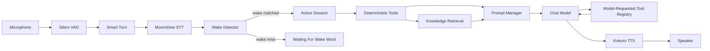
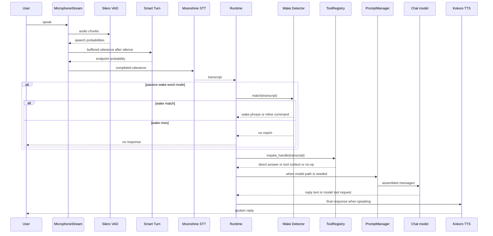
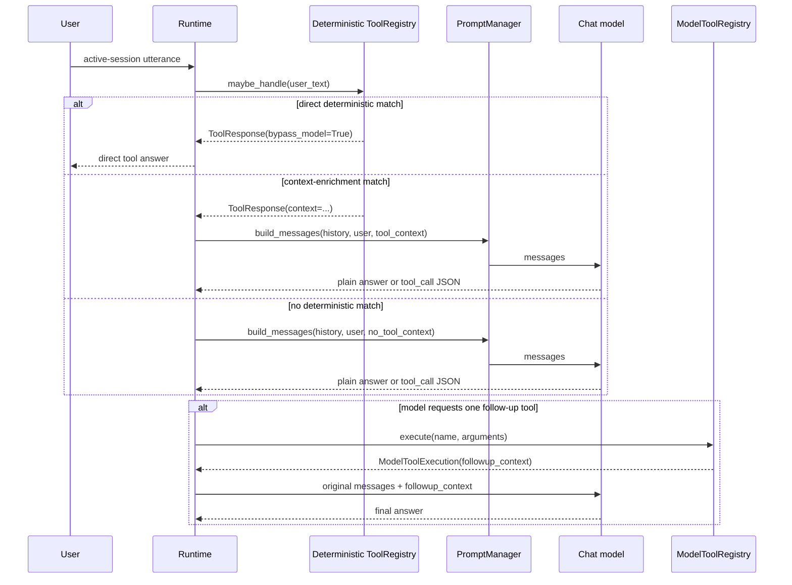
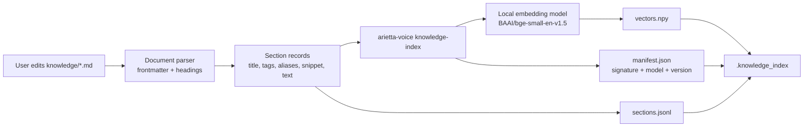
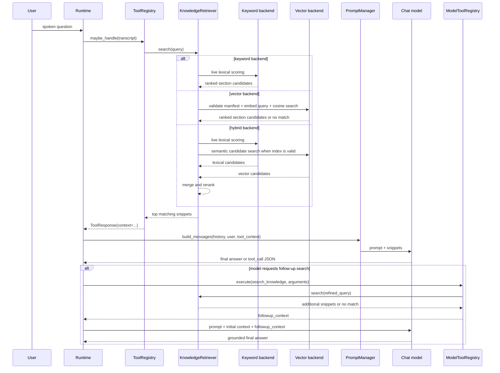

# Arietta Voice Technical Architecture

This document describes the implemented architecture of Arietta Voice.

## 1. Summary

Arietta Voice is a local-first, voice-first assistant runtime for Apple Silicon Macs. It is designed around a simple control loop:

1. listen continuously through the microphone
2. detect speech with VAD
3. transcribe completed utterances locally
4. use a wake word to enter an active session
5. answer with deterministic tools, model-requested tools, local knowledge, and a chat model
6. speak the response locally
7. return to wake-word mode after goodbye or session timeout

The architecture is intentionally small and modular, with the runtime centered on wake-word activation, local speech processing, grounded knowledge retrieval, and configurable tool execution.

## 2. Goals

- Keep the baseline runtime local-first and privacy-conscious.
- Make wake-word voice interaction the default operating mode.
- Preserve a clear seam between deterministic tools, knowledge retrieval, and model reasoning.
- Keep the project easy to customize without editing core runtime code.
- Support optional AWS Bedrock chat inference without changing the rest of the runtime.
- Make future home-automation expansion a tool-layer concern.

## 3. Major Components

| Concern | Primary module | Role |
| --- | --- | --- |
| CLI and config | `src/arietta_voice/cli.py`, `src/arietta_voice/config.py` | Entry point, typed config loading, runtime overrides |
| Wake word detection | `src/arietta_voice/wake.py` | Transcript-based wake-word matching and session activation |
| Audio I/O and barge-in | `src/arietta_voice/audio.py` | Mic capture, playback, and interruption handling |
| STT | `src/arietta_voice/stt.py` | Moonshine speech-to-text |
| VAD and endpointing | `src/arietta_voice/turn_detection.py` | Silero VAD and Smart Turn |
| Prompt assembly | `src/arietta_voice/prompts.py` | `SOUL.md`, memory, history, and tool context |
| Chat model | `src/arietta_voice/llm.py` | Local MLX or AWS Bedrock |
| Deterministic tools | `src/arietta_voice/tools/` | Pre-model routing and exact answers |
| Model-requested tools | `src/arietta_voice/model_tools/` | One model-selected follow-up lookup |
| Knowledge retrieval | `src/arietta_voice/knowledge.py` | Keyword, vector, or hybrid markdown retrieval |
| Runtime orchestration | `src/arietta_voice/runtime.py` | Main conversation loop |
| Diagnostics and logging | `src/arietta_voice/diagnostics.py`, `src/arietta_voice/logging_utils.py` | Startup checks and JSONL event logging |

## 4. High-Level Flow

## 5. Runtime Lifecycle

### 5.1 Warmup

The runtime performs a startup warmup in `AriettaVoiceRuntime.warmup()`:

- run diagnostics
- load VAD
- load STT
- load the configured chat model
- optionally load TTS
- optionally load Smart Turn
- create memory file if enabled
- preload knowledge backends

After warmup, the runtime enters `waiting_for_wake` unless wake words are disabled.

### 5.2 Passive listening

In passive mode, the runtime:

- buffers microphone chunks
- uses VAD to determine speech onset
- waits for a silence window
- optionally confirms end-of-turn with Smart Turn
- transcribes the utterance
- runs the wake detector against the transcript

If the transcript does not begin with a configured wake phrase, the utterance is ignored and the runtime stays passive.

### 5.2.1 Voice activity detection

The first layer of turn detection is VAD, implemented by `SileroVoiceActivityDetector` in `src/arietta_voice/turn_detection.py`.

Its job is simple: decide whether a small incoming audio chunk sounds like speech or not. The runtime calls VAD on every microphone chunk as audio arrives. If the returned speech probability is above the active threshold, the runtime treats that chunk as part of the user's utterance and keeps buffering. If the probability falls below the threshold, the runtime starts counting silence.

This makes VAD the low-latency gate for the live audio loop:

- it detects speech onset
- it decides whether the current chunk should be added to the utterance buffer
- it determines when the system has seen enough silence to consider ending the turn

The silence window is not hard-coded in frames. It is derived from the configured sample rate, chunk size, and `silence_ms` value. With the default configuration, the runtime processes 512-sample chunks at 16 kHz, so each chunk is roughly 32 milliseconds. A `silence_ms` value of 700 therefore means the runtime waits for about 700 milliseconds of silence before treating the utterance as a candidate endpoint.

VAD is intentionally fast and lightweight. It answers the immediate question "is the user speaking right now?" without trying to understand the larger conversational structure of the utterance.

### 5.2.2 Smart Turn endpoint validation

The second layer is Smart Turn, implemented by `SmartTurnEndpointDetector` in `src/arietta_voice/turn_detection.py`.

Smart Turn does not run on every incoming chunk. It only runs after VAD has already detected speech, the runtime has buffered an utterance, and the silence window has elapsed. At that point, Arietta Voice has a candidate end-of-turn, and Smart Turn is used to decide whether that silence really means the user is done.

Instead of looking at one tiny chunk, Smart Turn looks at the broader utterance context. The detector trims the buffered audio to the most recent 8 seconds, converts it into Whisper-style input features, and runs an ONNX model that returns an endpoint probability. That score is interpreted as "how likely is it that the user has actually finished their turn?"

If the endpoint probability is high enough, the runtime accepts the utterance as complete and sends it to STT. If the probability is too low, the runtime assumes the silence was just a pause, clears the silence counter, and keeps listening for more speech on the same turn.

### 5.2.3 Why Arietta Voice uses both

VAD and Smart Turn solve different problems, and using both produces more natural turn-taking than either one alone.

VAD is good at:

- reacting quickly to speech start and stop
- running continuously in the hot audio loop
- cheaply deciding whether the system should keep buffering audio

Smart Turn is good at:

- understanding whether a pause is a real conversational endpoint
- reducing premature cutoffs during natural hesitations
- validating candidate end-of-turn events after VAD has already narrowed the problem

If Arietta Voice used only VAD, it would be more likely to cut users off when they pause mid-sentence. If it used only Smart Turn, it would be doing a heavier endpoint inference task far more often than necessary. The two-stage design gives the runtime a good balance of responsiveness and conversational tolerance:

1. VAD says whether speech is happening at all.
2. VAD says when there has been enough silence to consider the turn complete.
3. Smart Turn decides whether that silence should actually end the turn.
4. Only then does the runtime transcribe the utterance and continue the assistant flow.

This is especially important for voice-first interactions, where small pauses are common and users often expect the assistant to tolerate a little hesitation without interrupting them.

### 5.3 Session activation

If the wake detector matches:

- a new session is opened
- the wake event is logged
- if the same utterance contains a trailing command, it is handled immediately
- otherwise the assistant speaks its acknowledgement and waits for the next turn

The active session stays open until:

- the user says goodbye
- the session times out after inactivity
- the process is stopped

### 5.4 Answer generation

Once a session is active, Arietta Voice answers turns in this order:

1. deterministic tools
2. prompt assembly with optional tool context
3. chat generation
4. optional single model-requested tool execution
5. final chat response
6. TTS playback with barge-in support

VAD also has a second role during playback. While the assistant is speaking, the runtime can optionally use acoustic echo cancellation to subtract its own TTS output from the microphone signal, then run VAD on the cleaned audio to detect user interruption. That allows Arietta Voice to stop speaking when the user starts talking over it, which makes the interaction feel much more conversational than a strict speak-then-wait loop.

### 5.5 Runtime turn sequence

## 6. Tooling Model

### 6.1 Deterministic tools

Deterministic tools live under `src/arietta_voice/tools/`.

They are checked in config order before the model is called. Each tool returns a `ToolResponse`.

Use this category when:

- matching is explicit
- the tool should directly answer
- the output is a source of truth

The built-in `local_time` tool is the reference example.

### 6.2 Model-requested tools

Model-requested tools live under `src/arietta_voice/model_tools/`.

The model sees a tool instruction block and may make at most one structured tool call. The runtime executes the tool and then gives the model one final answer turn with grounded follow-up context.

Use this category when:

- the model should decide whether the lookup is needed
- the tool is gathering context rather than speaking directly
- the workflow benefits from a single extra grounded step

### 6.3 Tool routing sequence

### 6.4 Ordering implications for deterministic tools

Deterministic tools are checked in configuration order and the registry stops at the first match. In practice, exact utility tools should appear earlier in the list, while broad fallback tools such as `knowledge_retrieval` should stay near the end.

This ordering matters because the deterministic registry is intentionally first-match-wins:

- `local_time` should beat broad retrieval for exact time questions
- custom exact-action tools should usually appear before `knowledge_retrieval`
- `knowledge_retrieval` works best as a fallback context provider after specific tools have already had their turn

### 6.5 Tool response modes

The deterministic tool layer supports two main response styles:

- direct answer: the tool returns `ToolResponse(bypass_model=True)`, so the runtime answers without calling the model
- prompt enrichment: the tool returns `ToolResponse(bypass_model=False, context=...)`, so the runtime injects context and still calls the model

Model-requested tools use `ModelToolExecution(followup_context=...)` instead of `ToolResponse`, because they always feed context back into a final model answer rather than bypassing the model directly.

## 7. Knowledge Architecture

Knowledge is authored as markdown under `knowledge/`.

Supported backends:

- `keyword`: live lexical retrieval over the markdown corpus
- `vector`: semantic retrieval over a local index
- `hybrid`: combined lexical and semantic ranking

The default configuration uses `keyword` so a new user can start adding knowledge without immediately building an embedding index.

When semantic search is desired, `knowledge-index` creates derived artifacts under `.knowledge_index/`.

### 7.1 Knowledge authoring and indexing

### 7.2 Knowledge runtime flow

### 7.3 Knowledge source and backend behavior

Knowledge retrieval has a few important architectural properties:

- source documents are markdown files under `knowledge/`
- supported source types are `.md`, `.markdown`, and `.txt`
- files named `README.md` and files beginning with `_` or `.` are ignored
- documents are parsed into heading-based sections with optional frontmatter metadata
- the semantic index is derived from the markdown source and validated against a directory signature

The three implemented retrieval modes differ like this:

- `keyword`: live lexical scoring only, no index required
- `vector`: semantic search against the derived index only
- `hybrid`: keyword plus vector candidate merging and reranking

## 8. Chat Provider Seam

The model adapter in `src/arietta_voice/llm.py` exposes a small protocol and two implementations:

- `GemmaChatModel` for local MLX inference
- `BedrockChatModel` for AWS Bedrock

Everything above the adapter stays the same regardless of provider:

- wake-word activation
- tools
- knowledge retrieval
- prompts
- memory
- TTS

## 9. Configuration Surface

The runtime is driven by a typed `AppConfig` object that contains:

- assistant profile
- wake-word settings
- audio settings
- model settings
- prompt file paths
- memory settings
- logging settings
- knowledge settings
- deterministic tool registration
- model-tool registration

This makes the boundary between runtime modules explicit and keeps config handling out of the main control loop.

## 10. Extensibility Strategy

The repository is meant to be extended in these directions:

- change persona and tone through `config/SOUL.md`
- add user-specific or environment-specific knowledge as markdown
- add deterministic tools for exact actions and lookups
- add model-requested tools for follow-up reasoning workflows
- replace or extend the wake detector backend
- switch between local and Bedrock chat providers with config only

The runtime itself should stay small and generic. Environment-specific behavior belongs in the prompt, knowledge base, or tools.
