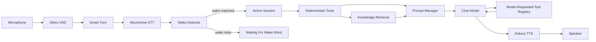

# Arietta Voice Technical Architecture

This document describes the implemented architecture of Arietta Voice.

## 1. Summary

Arietta Voice is a local-first, voice-first assistant runtime for Apple Silicon Macs. It is designed around a simple control loop:

1. listen continuously through the microphone
2. detect speech with VAD
3. transcribe completed utterances locally
4. use a wake word to enter an active session
5. answer with deterministic tools, model-requested tools, local knowledge, and a chat model
6. speak the response locally
7. return to wake-word mode after goodbye or session timeout

The architecture is intentionally small and modular, with the runtime centered on wake-word activation, local speech processing, grounded knowledge retrieval, and configurable tool execution.

## 2. Goals

- Keep the baseline runtime local-first and privacy-conscious.
- Make wake-word voice interaction the default operating mode.
- Preserve a clear seam between deterministic tools, knowledge retrieval, and model reasoning.
- Keep the project easy to customize without editing core runtime code.
- Support optional AWS Bedrock chat inference without changing the rest of the runtime.
- Make future home-automation expansion a tool-layer concern.

## 3. Major Components

| Concern | Primary module | Role |
| --- | --- | --- |
| CLI and config | `src/arietta_voice/cli.py`, `src/arietta_voice/config.py` | Entry point, typed config loading, runtime overrides |
| Wake word detection | `src/arietta_voice/wake.py` | Transcript-based wake-word matching and session activation |
| Audio I/O and barge-in | `src/arietta_voice/audio.py` | Mic capture, playback, and interruption handling |
| STT | `src/arietta_voice/stt.py` | Moonshine speech-to-text |
| VAD and endpointing | `src/arietta_voice/turn_detection.py` | Silero VAD and Smart Turn |
| Prompt assembly | `src/arietta_voice/prompts.py` | `SOUL.md`, memory, history, and tool context |
| Chat model | `src/arietta_voice/llm.py` | Local MLX or AWS Bedrock |
| Deterministic tools | `src/arietta_voice/tools/` | Pre-model routing and exact answers |
| Model-requested tools | `src/arietta_voice/model_tools/` | One model-selected follow-up lookup |
| Knowledge retrieval | `src/arietta_voice/knowledge.py` | Keyword, vector, or hybrid markdown retrieval |
| Runtime orchestration | `src/arietta_voice/runtime.py` | Main conversation loop |
| Diagnostics and logging | `src/arietta_voice/diagnostics.py`, `src/arietta_voice/logging_utils.py` | Startup checks and JSONL event logging |

## 4. High-Level Flow

## 5. Runtime Lifecycle

### 5.1 Warmup

The runtime performs a startup warmup in `AriettaVoiceRuntime.warmup()`:

- run diagnostics
- load VAD
- load STT
- load the configured chat model
- optionally load TTS
- optionally load Smart Turn
- create memory file if enabled
- preload knowledge backends

After warmup, the runtime enters `waiting_for_wake` unless wake words are disabled.

### 5.2 Passive listening

In passive mode, the runtime:

- buffers microphone chunks
- uses VAD to determine speech onset
- waits for a silence window
- optionally confirms end-of-turn with Smart Turn
- transcribes the utterance
- runs the wake detector against the transcript

If the transcript does not begin with a configured wake phrase, the utterance is ignored and the runtime stays passive.

### 5.3 Session activation

If the wake detector matches:

- a new session is opened
- the wake event is logged
- if the same utterance contains a trailing command, it is handled immediately
- otherwise the assistant speaks its acknowledgement and waits for the next turn

The active session stays open until:

- the user says goodbye
- the session times out after inactivity
- the process is stopped

### 5.4 Answer generation

Once a session is active, Arietta Voice answers turns in this order:

1. deterministic tools
2. prompt assembly with optional tool context
3. chat generation
4. optional single model-requested tool execution
5. final chat response
6. TTS playback with barge-in support

## 6. Tooling Model

### 6.1 Deterministic tools

Deterministic tools live under `src/arietta_voice/tools/`.

They are checked in config order before the model is called. Each tool returns a `ToolResponse`.

Use this category when:

- matching is explicit
- the tool should directly answer
- the output is a source of truth

The built-in `local_time` tool is the reference example.

### 6.2 Model-requested tools

Model-requested tools live under `src/arietta_voice/model_tools/`.

The model sees a tool instruction block and may make at most one structured tool call. The runtime executes the tool and then gives the model one final answer turn with grounded follow-up context.

Use this category when:

- the model should decide whether the lookup is needed
- the tool is gathering context rather than speaking directly
- the workflow benefits from a single extra grounded step

## 7. Knowledge Architecture

Knowledge is authored as markdown under `knowledge/`.

Supported backends:

- `keyword`: live lexical retrieval over the markdown corpus
- `vector`: semantic retrieval over a local index
- `hybrid`: combined lexical and semantic ranking

The default configuration uses `keyword` so a new user can start adding knowledge without immediately building an embedding index.

When semantic search is desired, `knowledge-index` creates derived artifacts under `.knowledge_index/`.

## 8. Chat Provider Seam

The model adapter in `src/arietta_voice/llm.py` exposes a small protocol and two implementations:

- `GemmaChatModel` for local MLX inference
- `BedrockChatModel` for AWS Bedrock

Everything above the adapter stays the same regardless of provider:

- wake-word activation
- tools
- knowledge retrieval
- prompts
- memory
- TTS

## 9. Configuration Surface

The runtime is driven by a typed `AppConfig` object that contains:

- assistant profile
- wake-word settings
- audio settings
- model settings
- prompt file paths
- memory settings
- logging settings
- knowledge settings
- deterministic tool registration
- model-tool registration

This makes the boundary between runtime modules explicit and keeps config handling out of the main control loop.

## 10. Extensibility Strategy

The repository is meant to be extended in these directions:

- change persona and tone through `config/SOUL.md`
- add user-specific or environment-specific knowledge as markdown
- add deterministic tools for exact actions and lookups
- add model-requested tools for follow-up reasoning workflows
- replace or extend the wake detector backend
- switch between local and Bedrock chat providers with config only

The runtime itself should stay small and generic. Environment-specific behavior belongs in the prompt, knowledge base, or tools.
