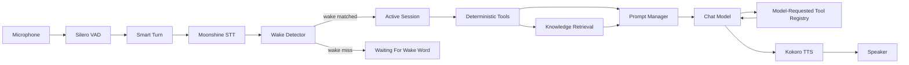
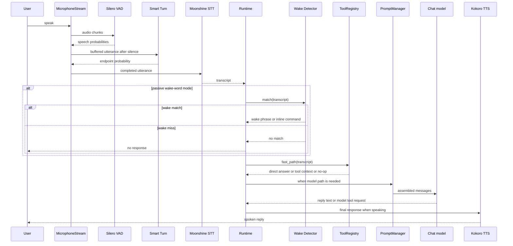
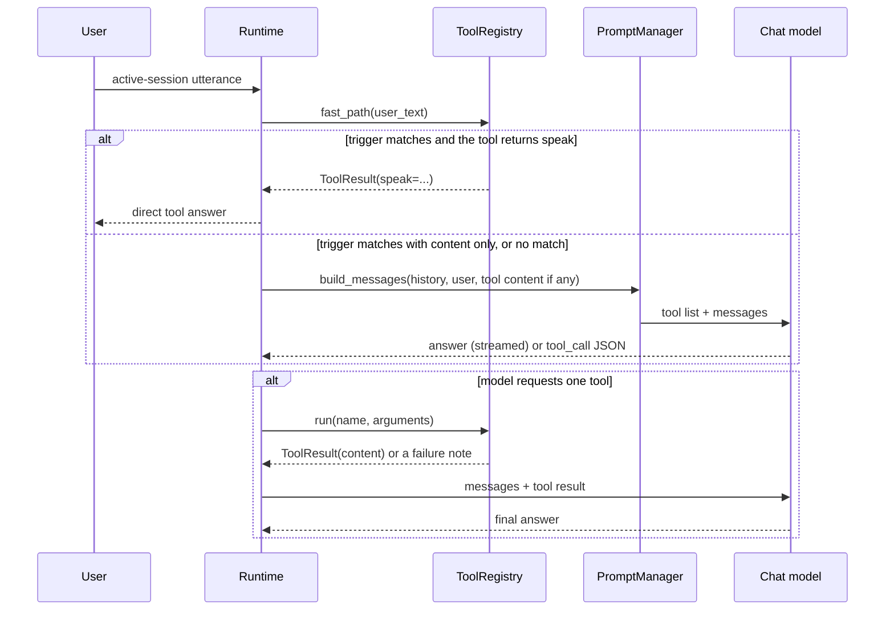
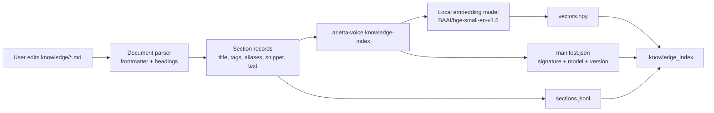
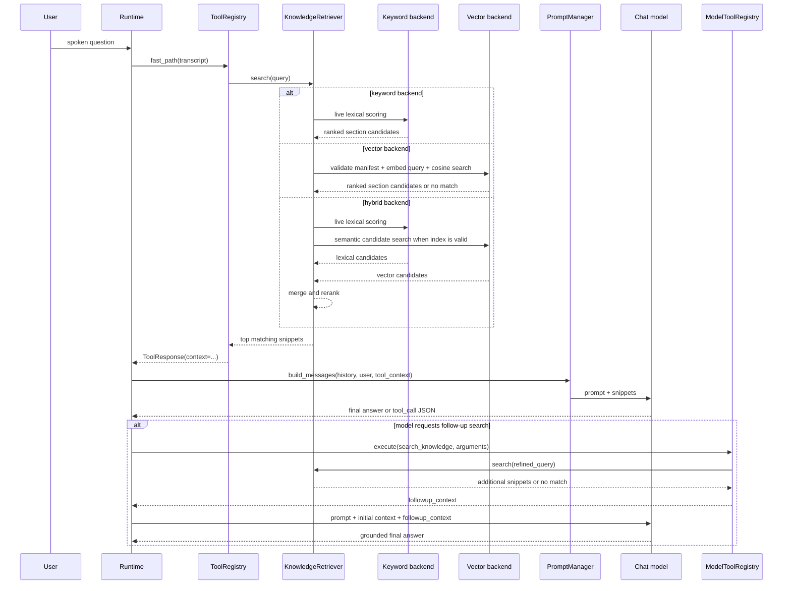

# Arietta Voice Technical Architecture

This document describes the implemented architecture of Arietta Voice.

## 1. Summary

Arietta Voice is a local-first, voice-first assistant runtime for Apple Silicon Macs. It is designed around a simple control loop:

1. listen continuously through the microphone
2. detect speech with VAD
3. transcribe completed utterances locally
4. use a wake word to enter an active session
5. answer with tools (instant answers or model calls), local knowledge, and a chat model
6. speak the response locally
7. return to wake-word mode after goodbye or session timeout

The architecture is intentionally small and modular, with the runtime centered on wake-word activation, local speech processing, grounded knowledge retrieval, and configurable tool execution.

## 2. Goals

- Keep the baseline runtime local-first and privacy-conscious.
- Make wake-word voice interaction the default operating mode.
- Preserve a clear seam between tools, knowledge retrieval, and model reasoning.
- Keep the project easy to customize without editing core runtime code.
- Support optional AWS Bedrock chat inference without changing the rest of the runtime.
- Make future home-automation expansion a tool-layer concern.

## 3. Major Components

| Concern | Primary module | Role |
| --- | --- | --- |
| CLI and config | `src/arietta_voice/cli.py`, `src/arietta_voice/config.py` | Entry point, typed config loading, runtime overrides |
| Wake word detection | `src/arietta_voice/wake.py` | Transcript-based wake-word matching and session activation |
| Audio I/O and barge-in | `src/arietta_voice/audio.py` | Mic capture, playback, and interruption handling |
| STT | `src/arietta_voice/stt.py` | Moonshine speech-to-text |
| VAD and endpointing | `src/arietta_voice/turn_detection.py` | Silero VAD and Smart Turn |
| Prompt assembly | `src/arietta_voice/prompts.py` | `SOUL.md`, memory, history, and tool context |
| Chat model | `src/arietta_voice/llm.py` | Local MLX or AWS Bedrock |
| Tools | `src/arietta_voice/tools/` | One tool interface: registry, argument schemas, built-in tools |
| User tools | `tools/` | Your own tools, one file each, outside the installed package |
| Knowledge retrieval | `src/arietta_voice/knowledge.py` | Keyword, vector, or hybrid markdown retrieval |
| Runtime orchestration | `src/arietta_voice/runtime.py` | Main conversation loop |
| HTTP API and admin console | `src/arietta_voice/web/` | Authenticated API, admin UI, health, logs, diagnostics, chat, tools, and knowledge |
| Runtime status heartbeat | `src/arietta_voice/runtime_status.py` | Shared status file used by the web console to detect a separately running voice process |
| Runtime process supervisor | `src/arietta_voice/runtime_supervisor.py` | Starts, stops, restarts, and logs an API-managed voice runtime child process |
| Diagnostics and logging | `src/arietta_voice/diagnostics.py`, `src/arietta_voice/logging_utils.py` | Startup checks and JSONL event logging |

## 4. High-Level Flow

## 5. Runtime Lifecycle

### 5.1 Warmup

The runtime performs a startup warmup in `AriettaVoiceRuntime.warmup()`:

- run diagnostics
- load VAD
- load STT
- load the configured chat model
- optionally load TTS
- optionally load Smart Turn
- create memory file if enabled
- preload knowledge backends

After warmup, the runtime enters `waiting_for_wake` unless wake words are disabled.

### 5.2 Passive listening

In passive mode, the runtime:

- buffers microphone chunks
- uses VAD to determine speech onset
- waits for a silence window
- optionally confirms end-of-turn with Smart Turn
- transcribes the utterance
- runs the wake detector against the transcript

If the transcript does not begin with a configured wake phrase, the utterance is ignored and the runtime stays passive.

### 5.2.1 Voice activity detection

The first layer of turn detection is VAD, implemented by `SileroVoiceActivityDetector` in `src/arietta_voice/turn_detection.py`.

Its job is simple: decide whether a small incoming audio chunk sounds like speech or not. The runtime calls VAD on every microphone chunk as audio arrives. If the returned speech probability is above the active threshold, the runtime treats that chunk as part of the user's utterance and keeps buffering. If the probability falls below the threshold, the runtime starts counting silence.

This makes VAD the low-latency gate for the live audio loop:

- it detects speech onset
- it decides whether the current chunk should be added to the utterance buffer
- it determines when the system has seen enough silence to consider ending the turn

The silence window is not hard-coded in frames. It is derived from the configured sample rate, chunk size, and `silence_ms` value. With the default configuration, the runtime processes 512-sample chunks at 16 kHz, so each chunk is roughly 32 milliseconds. A `silence_ms` value of 700 therefore means the runtime waits for about 700 milliseconds of silence before treating the utterance as a candidate endpoint.

VAD is intentionally fast and lightweight. It answers the immediate question "is the user speaking right now?" without trying to understand the larger conversational structure of the utterance.

### 5.2.2 Smart Turn endpoint validation

The second layer is Smart Turn, implemented by `SmartTurnEndpointDetector` in `src/arietta_voice/turn_detection.py`.

Smart Turn does not run on every incoming chunk. It runs after VAD has detected speech and the runtime has buffered an utterance, at two points: an early check after `endpoint_early_ms` of silence (250 ms by default), which starts a provisional turn when the model is confident (`endpoint_early_threshold`, 0.7), and the normal check once the full silence window has elapsed. A provisional turn is discarded, and the utterance continues, if speech resumes before the full window has passed. At that point, Arietta Voice has a candidate end-of-turn, and Smart Turn is used to decide whether that silence really means the user is done.

Instead of looking at one tiny chunk, Smart Turn looks at the broader utterance context. The detector trims the buffered audio to the most recent 8 seconds, converts it into Whisper-style input features, and runs an ONNX model that returns an endpoint probability. That score is interpreted as "how likely is it that the user has actually finished their turn?"

If the endpoint probability is high enough, the runtime accepts the utterance as complete and sends it to STT. If the probability is too low, the runtime assumes the silence was just a pause, clears the silence counter, and keeps listening for more speech on the same turn.

### 5.2.3 Why Arietta Voice uses both

VAD and Smart Turn solve different problems, and using both produces more natural turn-taking than either one alone.

VAD is good at:

- reacting quickly to speech start and stop
- running continuously in the hot audio loop
- cheaply deciding whether the system should keep buffering audio

Smart Turn is good at:

- understanding whether a pause is a real conversational endpoint
- reducing premature cutoffs during natural hesitations
- validating candidate end-of-turn events after VAD has already narrowed the problem

If Arietta Voice used only VAD, it would be more likely to cut users off when they pause mid-sentence. If it used only Smart Turn, it would be doing a heavier endpoint inference task far more often than necessary. The two-stage design gives the runtime a good balance of responsiveness and conversational tolerance:

1. VAD says whether speech is happening at all.
2. VAD says when there has been enough silence to consider the turn complete.
3. Smart Turn decides whether that silence should actually end the turn.
4. Only then does the runtime transcribe the utterance and continue the assistant flow.

This is especially important for voice-first interactions, where small pauses are common and users often expect the assistant to tolerate a little hesitation without interrupting them.

### 5.3 Session activation

If the wake detector matches:

- a new session is opened
- the wake event is logged
- if the same utterance contains a trailing command, it is handled immediately
- otherwise the assistant speaks its acknowledgement and waits for the next turn

The active session stays open until:

- the user says goodbye
- the session times out after inactivity
- the process is stopped

### 5.4 Answer generation

Once a session is active, Arietta Voice answers turns in this order:

1. instant answers from tool triggers
2. prompt assembly with optional tool context
3. chat generation, streamed
4. optional single tool call requested by the model
5. final chat response
6. TTS playback with barge-in support

VAD also has a second role during playback. While the assistant is speaking, the runtime can optionally use acoustic echo cancellation to subtract its own TTS output from the microphone signal, then run VAD on the cleaned audio to detect user interruption. That allows Arietta Voice to stop speaking when the user starts talking over it, which makes the interaction feel much more conversational than a strict speak-then-wait loop.

### 5.5 Runtime turn sequence

## 6. Tooling Model

### 6.1 One tool interface

Every tool, built in (`src/arietta_voice/tools/builtin/`) or yours (`tools/`), is
a class with a `name`, a `description` of when to use it, a JSON-schema
`parameters` object, optional `triggers`, a `timeout_s` and a `run(arguments)`
method returning a `ToolResult`. `ToolResult.content` is information for the
model; `ToolResult.speak` is a finished answer for the user.

`ToolRegistry` (`src/arietta_voice/tools/registry.py`) loads the tools listed in
`[tools].enabled`, in order. When the private config has its own list,
`merge_tool_lists` (`config.py`) adds each standard tool that is in neither that
list nor `[tools].disabled`, just before the next standard tool in it, so tools
from a newer release switch on after an upgrade. A list saved before `disabled`
existed is read against the standard tools of the newest release it mentions. A tool that fails to load is recorded in
`registry.errors` and skipped, so one broken file does not disable the rest.
Before a tool runs, its arguments are checked against its schema; it then runs
in a thread with its time limit, and its result is truncated to bounded sizes.

### 6.2 Instant answers

Before the model is called, each enabled tool's triggers are tried in
configuration order and the first match runs. If its result has `speak`, that is
the answer and the model is not called. If it has only `content`, the content is
added to the prompt and the model answers with it. `search_knowledge` uses this
to add relevant notes to every request, so it belongs at the end of the list.
A tool that fails here is skipped and the next one is tried.

### 6.3 Model calls

Tools with `model_callable` set (the default) are offered to the model in one
of two ways.

**Native calls (local model).** The tools are declared through Gemma 4's own
chat template, in the system turn, so the declarations are part of the cached
prompt prefix. The model answers with `<|tool_call>call:name{...}<tool_call|>`
and stops; the call is parsed (`model_tooling.parse_native_tool_calls`),
validated and run, and the result goes back as a `tool` message. The model then
continues the same turn, and may call again, up to three tools per turn
(`conversation.MAX_TOOL_STEPS`), after which the turn ends with an apology.
Words the model says before a call are spoken and the answer continues after
it. With tools declared Gemma 4 tends to reason in a hidden channel first, which
cost 10 to 20 seconds, so the token that opens that channel is ruled out with a
logit bias, and any channel text that still appears is never spoken. Set
`models.native_tool_calls = false` to use the prompted format instead.

**Prompted JSON (Bedrock, or native calls off).** The tools are described in a
system message with argument examples, and the model may reply with one JSON
tool call; its result is added as context and the model answers.

Either way, a tool that is unknown, gets invalid arguments, fails or times out
is reported to the model, which answers without it. A tool with
`speaks_for_itself` (the timer tools) answers with its own `speak` instead of a
second generation, which is faster and cannot misstate what the tool did. Tools
run in the background; one still working after 0.8 seconds gets a spoken "One
moment." (once per turn), which the speech pipeline says while the tool
finishes and which is not part of the recorded answer. The
model's first response is streamed, so a direct answer is spoken as it is
generated.

### 6.4 Tool routing sequence

### 6.5 Timers, reminders and alarms

Timers, reminders and alarms are built-in tools (`set_timer`, `set_reminder`,
`set_alarm`, `check_timers`, `cancel_timer`) over one store, `TimerStore`, in
`arietta_voice/timers.py`. Three processes use it: tools run in the inference
worker, the voice runtime announces what is due, and the console lists, adds and
cancels. The store is a small JSON file (`timers.path`, `state/timers.json` by
default). Every change takes an exclusive `flock` on a sidecar lock file and
replaces the file atomically with owner-only permissions, so a worker stopped
mid-write cannot leave it half written. An unreadable file is moved aside and a
fresh one started; malformed entries are dropped on read.

Each alert is `pending` until due, then `ringing`, then `done` with an outcome
(dismissed, acknowledged, snoozed back to pending, cancelled or unanswered).
Finished alerts are kept for a day for the console.

`AlertScheduler` is the runtime's view of the store. The listening loop asks it
for due alerts on every pass, which costs one `stat` unless the file changed,
and only when no speech is being captured, so an alert never talks over the
user and waits for a turn in progress to finish. Due alerts are spoken through
the normal answer path, led by a short tone, with barge-in as for any answer.
A ringing alert repeats every `timers.repeat_s` until answered, at most
`timers.max_repeats` more times. The scheduler also remembers when it last
rang each alert, so a store that cannot be written does not make an alert ring
on every pass.

While an alert rings, "stop" and "snooze" are handled by the runtime itself,
before the model and without the wake word; any other turn counts as having
heard it. With the wake word on, nothing else is answered without it.

`arietta_voice/timephrases.py` reads durations and times of day as speech
recognition writes them, in digits or words ("ten minutes", "an hour and a half",
"five thirty pm", "tomorrow at 9"), and says them back. A phrase is accepted only
when it is understood completely, which lets the reminder tool find where the
time phrase starts in "remind me to put the kids in bed at 8".

## 7. Knowledge Architecture

Knowledge is authored as markdown under `knowledge/`.

Supported backends:

- `keyword`: live lexical retrieval over the markdown corpus
- `vector`: semantic retrieval over a local index
- `hybrid`: combined lexical and semantic ranking

The default configuration uses `keyword` so a new user can start adding knowledge without immediately building an embedding index.

When semantic search is desired, `knowledge-index` creates derived artifacts under `.knowledge_index/`.

The BGE v1.5 adapter uses the first token (CLS) followed by L2 normalization for
both documents and prefixed queries. Index format 2 records `embedding_pooling`
as `cls-normalized`; loaders and the builder reject the previous mean-pooling
pipeline. Source enumeration excludes hidden/underscore-prefixed paths and
links outside the configured root.

### 7.1 Knowledge authoring and indexing

### 7.2 Knowledge runtime flow

### 7.3 Knowledge source and backend behavior

Knowledge retrieval has a few important architectural properties:

- source documents are markdown files under `knowledge/`
- supported source types are `.md`, `.markdown`, and `.txt`
- files named `README.md` and files beginning with `_` or `.` are ignored
- documents are parsed into heading-based sections with optional frontmatter metadata
- the semantic index is derived from the markdown source and validated against a directory signature

The three implemented retrieval modes differ like this:

- `keyword`: live lexical scoring only, no index required
- `vector`: semantic search against the derived index only
- `hybrid`: keyword plus vector candidate merging and reranking

## 8. Chat Provider Seam

The model adapter in `src/arietta_voice/llm.py` exposes a small protocol and two implementations:

- `GemmaChatModel` for local MLX inference
- `BedrockChatModel` for AWS Bedrock

Everything above the adapter stays the same regardless of provider:

- wake-word activation
- tools
- knowledge retrieval
- prompts
- memory
- TTS

## 9. Configuration Surface

The runtime is driven by a typed `AppConfig` object that contains:

- assistant profile
- wake-word settings
- audio settings
- model settings
- prompt file paths
- memory settings
- logging settings
- knowledge settings
- enabled tools and the user tools directory
- where timers and reminders are kept, and how alerts repeat

This makes the boundary between runtime modules explicit and keeps config handling out of the main control loop.

The TOML loader validates types, known keys, and runtime constraints before
model construction. CLI overrides are validated again. History limits count
user/assistant pairs, with zero retaining no history. `use_tools=false` in an
API chat skips instant answers and the tool registry.

Configuration resolves built-in defaults, a selected base TOML, its sibling
`.local.toml`, then CLI runtime overrides. Tables merge by setting and arrays
replace. `config-init` snapshots effective settings and the current persona
into private files without changing originals; admin tool selections update
private TOML under a process lock with atomic replacement. The snapshot points
`prompts.soul_path` to the private persona file.

Admin credentials load once at API startup from explicit environment credentials
or an owner-only JSON hash file created by `admin-setup`. No default password or
authentication bypass remains. The stored format uses a random 16-byte salt and
600,000 PBKDF2-SHA256 iterations; credential rotation requires an API restart.
Source creation/writes require a separate config permission. Tool inventory and
source reads parse AST/literal metadata and never resolve external packages by
importing their parents. Runtime validity/activity is unknown until an explicit
validation/execution action. Instruction preview is a POST because it imports
enabled tools. Host and browser-origin checks protect local HTTP admin actions;
remote deployment still requires HTTPS.

Public `/health` provides liveness and version only. Authenticated `/api/health`
retains diagnostics. `logging.content_enabled` defaults to false and controls
active conversation text in runtime logging and status; passive wake misses
never persist transcript text. Status reads also redact legacy transcript
fields. Interactive text output remains available, while redirected responses
respect the content setting.

JSONL appends and rotation share a stable sidecar `flock` across the API and
runtime processes. `max_bytes` bounds each newly written log, `backup_count`
controls retained archives, and oversized records become metadata-only markers.
This rotation applies to the event file, not external launchd stdout/stderr logs.

## 10. Extensibility Strategy

The repository is meant to be extended in these directions:

- change persona and tone through ignored `config/SOUL.local.md`
- add user-specific or environment-specific knowledge as markdown
- add tools with triggers for exact actions and lookups
- add model-requested tools for follow-up reasoning workflows
- replace or extend the wake detector backend
- switch between local and Bedrock chat providers with config only

The runtime itself should stay small and generic. Environment-specific behavior belongs in the prompt, knowledge base, or tools.
